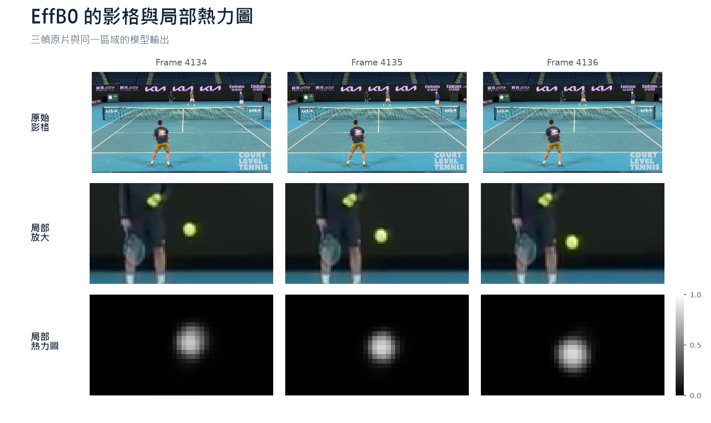
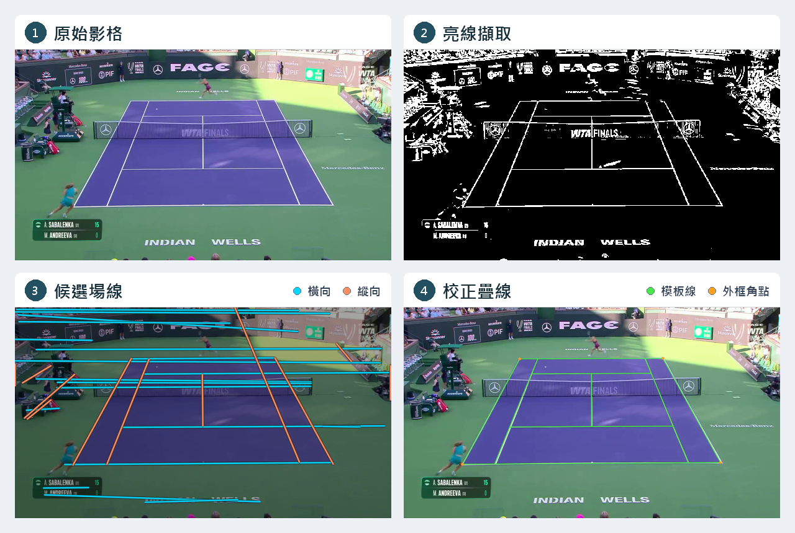
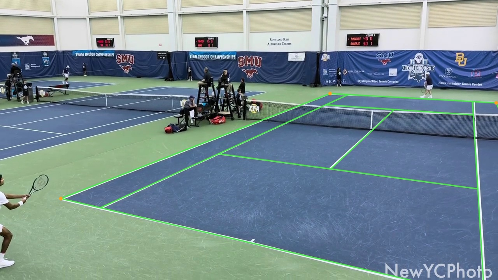
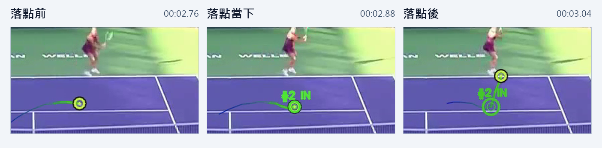
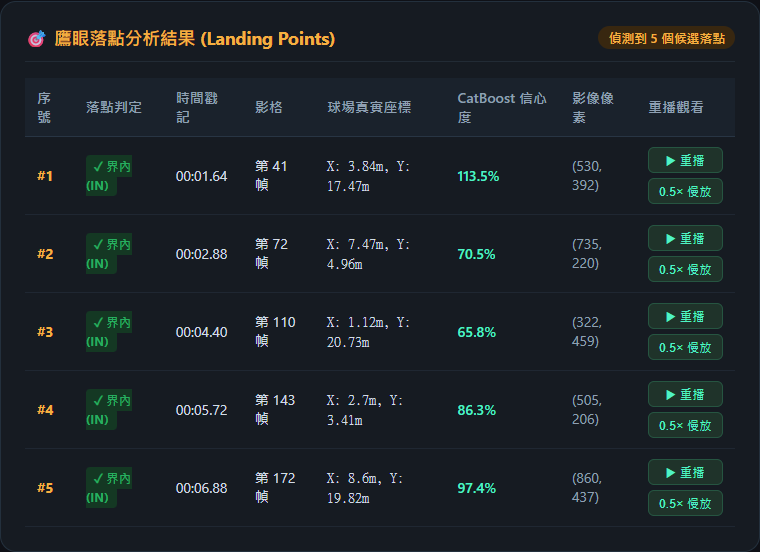
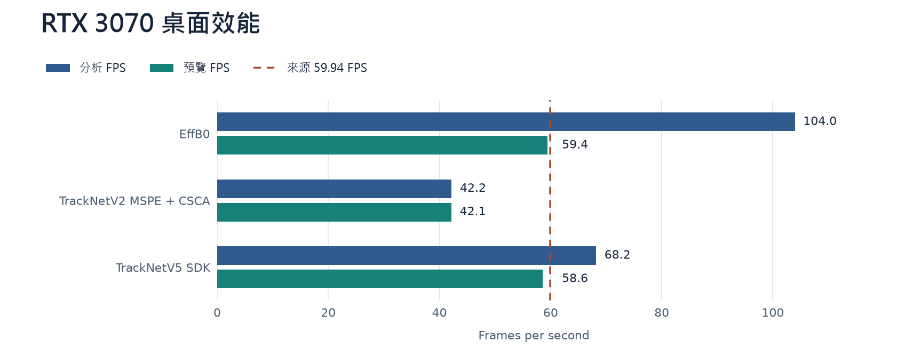

# Tennis Tracker

本專案從單一視角的網球影片估計**球場幾何、球體軌跡與候選落點**。桌面版支援影片與攝影機，Web 版可上傳影片並下載帶標記的結果。另提供獨立場地校正工具。

[如何實現](#如何實現) · [實際畫面](#實際畫面) · [落點重播與慢放](#落點重播與慢放) · [實測比較](#實測比較) · [安裝與啟動](#安裝與啟動)

## 如何實現

1. **追蹤與落點**。先從球位置熱力圖取得候選球位，再用軌跡連續性抑制跳點。具備有效場地校正時，可用 CatBoost 對連續球位的運動特徵評估候選落點，再依該影格的場地投影估計界內外。畫面中的速度是地面投影估速，會受球的離地高度影響。
2. **場地校正**。從底線、邊線與發球區標線估計影像平面到球場平面的單應矩陣。低視角或斜拍時，程式也會搜尋傾斜的底線及近乎垂直的邊線，以畫面上仍可見的標線驗證投影。場線短暫受遮擋時可保留外框供確認，期間暫停落點判定。切鏡時重新校正。
3. **預覽同步**。桌面背景分析預設全速。分析跟得上時，預覽按來源影片的時間播放。落後時，預覽等下一幀的分析完成，再顯示同一幀的畫面與標記。也可手動將分析限制在來源 FPS。Web 完成分析後可按來源 FPS 播放或下載匯出影片。

### 預設球體模型 EffB0

EffB0 是專案的預設球追蹤模型。它採用 EfficientNetV2-B0 作為特徵編碼器，並用多尺度池化（MSPE）及通道與空間注意力（CSCA）融合解碼特徵。模型將三個連續的 512 × 288 RGB 影格合併輸入，為每幀輸出一張球位置熱力圖。[模型程式](working/desktop/tracknet_v2_b0_mspe_csca.py) · [Tan 與 Le 的 EfficientNetV2 論文，ICML 2021](https://proceedings.mlr.press/v139/tan21a.html)



每欄對應一個影格。上排是原片，中排放大球所在的同一區域，下排顯示模型在該區域的熱力圖。三張熱力圖共用 0 到 1 的灰階。

### 場地校正怎麼做

**原始影格 → 亮線擷取 → 霍夫候選線 → 校正疊線**



霍夫轉換讓亮線像素對可能的直線投票，找出底線、邊線與發球線的候選線段。候選線與標準球場模板配對，再用其他場線驗證投影。低視角或斜拍時，依仍可辨認的標線確認球場位置。切鏡後重新校正。[場地工具與輸出格式](working/court/README.md)

### 場地校正回歸

桌面版在載入球模型前，用影片首幀啟動場地搜尋。相同影格與解析度的場線搜尋結果可重用，並沿用跨幀確認及切鏡重設。

| 影片片段 | 調整前首次鎖定 | 調整後首次鎖定 |
| --- | ---: | ---: |
| Alcaraz／Ruud 低視角片段 | 第 64 幀 | 第 13 幀 |
| 室外低視角 `9.MOV` | 第 22 幀 | 第 10 幀 |

幀數從各片段的第一幀起算。練習影片開頭 800 幀另做切鏡測試，兩次切鏡都清除舊場地並重新鎖定。[場地鎖定實測](docs/benchmarks/court-startup.json)

## 實際畫面

### 低視角與斜拍校正

下圖左側為原始影格，右側為自動校正。下排近端底線已出畫，投影根據仍可見的場線求得。


斜拍影片 `test7.mp4` 的近底線斜向右下，一側單打線接近垂直。抽查三個各 90 幀的片段，三段有場地校正的幀數皆由 0 提升至 84，並各在第 7 幀鎖定。回歸樣本也涵蓋轉播視角、其他低視角與無可用標線的特寫。[視角回歸數據](docs/benchmarks/court-angles.json)



### 落點前後的球體運動

`test4.mp4` 中一段包含 13 個連續影格的局部畫面。黃色 EVENT 標示系統提出的候選落點，可沿前後球位查看球的下降和反彈。


### 桌面介面

桌面畫面同時顯示場地投影、球跡、2D 小球場與背景分析落點表。頂端會分開顯示來源、預覽及分析 FPS。


<details>
<summary>查看 TrackNetV2 與 TrackNetV5 SDK 的桌面截圖</summary>


</details>

### Web 介面

Web 版分析完成後，可在同一頁預覽與下載帶標記的影片。候選落點表會顯示時間、球場座標、界內外估計與模型評分。

#### 落點重播與慢放

在候選落點表找到想看的紀錄，再選擇該列右側的播放方式。

- **重播（1×）**以原速播放。慢放時也可點這個按鈕切回原速。
- **0.5× 慢放**以半速播放，方便觀察球的下降、觸地和反彈。

兩個按鈕都會讓表格上方的影片播放器從落點前 1 秒開始。距離片頭不到 1 秒時，從 00:00 開始。例如第 2 筆落點在 00:02.88，點擊後從 00:01.88 播放。

下圖以第 2 筆候選落點為例，擷取同一區域的三個影格。00:02.76 時球正下降，00:02.88 時出現 `#2 IN` 落點標記，00:03.04 時球已向右上反彈，落點標記留在原處。



#### Web 操作畫面

下圖是第 2 筆落點以 0.5× 播到 00:02.88 時暫停的畫面，對應上方三幀對照的中央影格。


<details>
<summary>查看分析完成與落點表截圖</summary>




</details>

## 實測比較

三款模型在 GeForce RTX 3070 8 GB 上各跑一輪。使用同一段 Alcaraz 與 Ruud 練習影片，解析度 1280 × 720，來源 59.94 FPS。取樣範圍約 00:09 至 01:09，共 3,597 幀。測試固定每批 3 幀，開啟桌面預覽與即時場地校正，關閉分析限速。計時從模型載入完成後開始。



| 模型 | 推論設定 | 分析 FPS | 預覽 FPS | 分析耗時（秒） | 有球位置的幀數 | 落點紀錄 |
| --- | --- | ---: | ---: | ---: | ---: | ---: |
| EffB0 | FP16 AMP | **104.0** | 59.4 | 34.6 | 3,347 | 43 |
| TrackNetV2 MSPE + CSCA | FP16 AMP | **42.2** | 42.1 | 85.3 | 2,982 | 40 |
| TrackNetV5 SDK | FP32 | **68.2** | 58.6 | 52.8 | 3,086 | 42 |

分析 FPS 以完成分析的來源幀數計算，預覽 FPS 以視窗實際更新的新影格計算。EffB0 約 60 秒播完，背景分析提早結束。V2 跟隨分析進度，約 85.2 秒播完，顯示的 3,593 幀都有同幀分析結果。

EffB0 和 V2 以目前的預覽同步模式實測，V5 採用本機完整版先前的原速播放數據。此發布包提供 EffB0 和 TrackNetV2。表中的球位與落點皆為程式輸出計數。[實測資料](docs/benchmarks/rtx3070-desktop.json)

## 安裝與啟動

建議在 Windows 使用含 Tkinter 的 Python 3.12。影片匯出建議將支援 H.264 的 FFmpeg 放入 `PATH`。

```powershell
py -3.12 -m venv .venv
.\.venv\Scripts\python.exe -m pip install -r requirements.txt
```

使用 NVIDIA GPU 時，可先為同一虛擬環境選擇適合的 `torch`、`torchvision`，再安裝上方其餘依賴。[PyTorch 安裝選擇器](https://pytorch.org/get-started/locally/)

桌面版預設使用 EffB0，也可切換 TrackNetV2。Web 版使用 EffB0。球追蹤權重由本機提供，CatBoost 落點權重可選用。[球追蹤權重](working/desktop/model/README.md) · [落點權重](working/models/README.md)

| 啟動方式 | 用途 |
| --- | --- |
| `START_DESKTOP.cmd` | 開啟桌面版，選擇影片或攝影機 |
| `START_WEB.cmd` | 啟動 Web 服務並在瀏覽器開啟 `http://127.0.0.1:8018` |

啟動檔使用專案的 `.venv`。Web 可透過 `python start_web.py --port 8018` 指定埠號，分析結果存於 `working/web/outputs/`。

| 環境變數 | 用途 |
| --- | --- |
| `TENNIS_PYTHON` | 指定 Python 執行檔 |
| `TENNIS_WEIGHTS_DIR` | 指定球追蹤權重資料夾 |
| `TENNIS_BOUNCE_MODEL` | 指定 CatBoost 的 `.cbm` 模型檔 |

### 單獨執行場地校正

場地工具直接從影像標線估計幾何，安裝 `requirements-court.txt` 後即可使用。影片匯出需要 FFmpeg。

```powershell
.\.venv\Scripts\python.exe -m pip install -r requirements-court.txt
.\.venv\Scripts\python.exe working/court/track_video.py ./match.mp4 --output ./court_output
```

校正可靠度取決於仍可辨認的標線。大斜角、嚴重遮擋或多座球場同框的畫面仍可能無法確認場地。球場尺寸依循 ITF 規格，場線配對參考 Dirk Farin 等人的方法。[場地工具與參考資料](working/court/README.md)

## 重現與驗證

發布包已通過 131 項 Python 測試及 8 項前端檢查。EffB0 和 TrackNetV2 均以實際權重測試 CUDA 推論。另抽查同段影片的 72 幀，EffB0 以 CUDA Graph 和標準 AMP 推論所得的熱力圖逐值一致。

```powershell
.\.venv\Scripts\python.exe -m pip install -r requirements-dev.txt
.\.venv\Scripts\python.exe -m unittest discover -s tests -v
node tests/test_frontend.js
```

回歸測試使用合成影格與測試資料。放置模型權重後，可另執行 `python tests/smoke_models.py --model EfficientNetV2-B0` 驗證實際模型推論。

| 路徑 | 內容 |
| --- | --- |
| `working/court/` | 場線擷取、透視校正與跨幀追蹤 |
| `working/desktop/` | 桌面介面、球追蹤模型與推論 |
| `working/web/` | Web 服務、落點分析與匯出 |
| `tests/` | 場地、推論、播放與輸出的回歸測試 |
