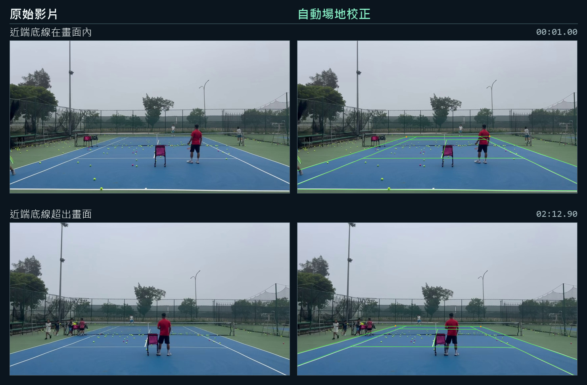
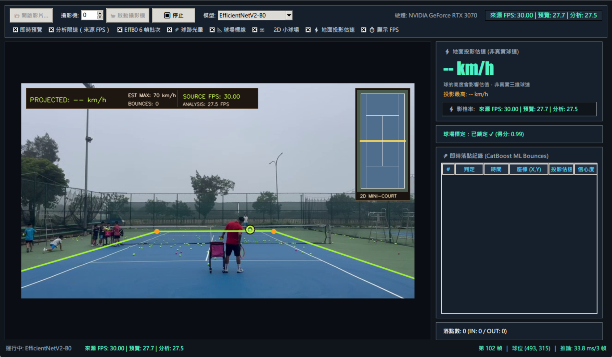
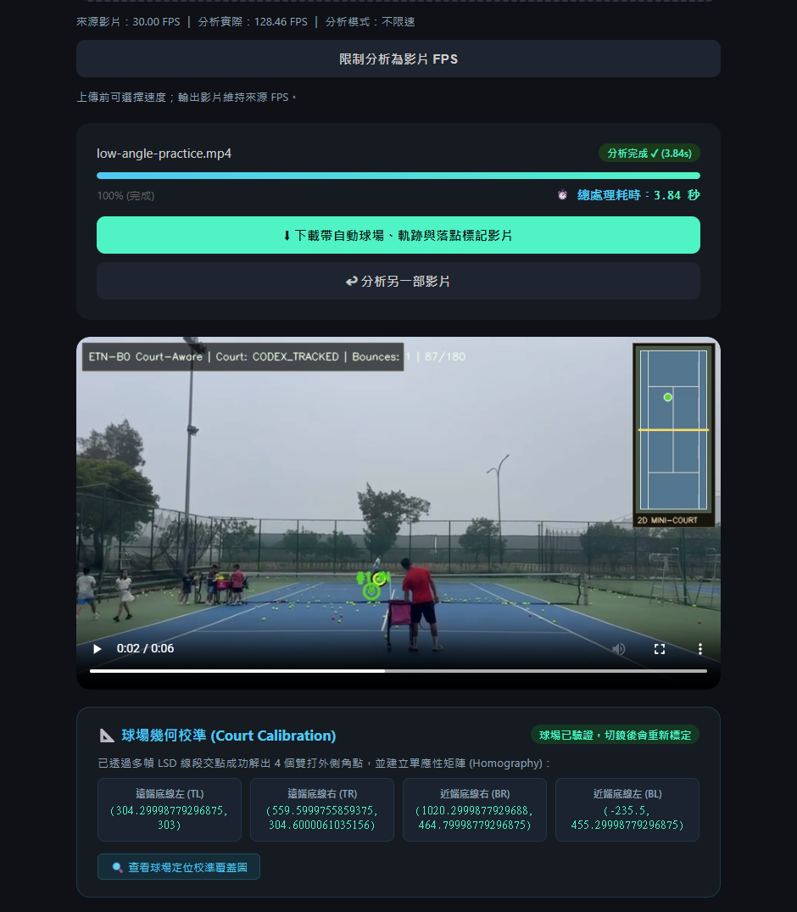

# Tennis Tracker

網球影片的自動場地校正、球體追蹤與落點分析。提供 Windows 桌面版、在本機瀏覽器使用的 Web 版，以及只偵測球場的命令列工具。

[這版做了什麼](#這版做了什麼) · [實際畫面](#實際畫面) · [安裝與啟動](#在-windows-安裝)

## 這版做了什麼

- **讓低視角也能自動校正**。加入斜率較小的邊線和較淡的發球線候選。近端底線出畫時，改用左右邊線、近端發球線、遠端標線及中線驗證透視投影，從可見的場線推算畫面外的位置。
- **減少場地框閃爍**。新構圖先經過跨影格確認，接著用當前場線與鏡頭位移更新位置。場線短暫被遮住時，介面可保留外框供重新確認，這段期間會暫停落點判定。切鏡時清除舊校正並重新定位。
- **讓限速跟著影片 FPS**。桌面和 Web 預設不限速，可切換成來源 FPS。來源 FPS 與實測分析速度分開顯示，Web 匯出也保留來源 FPS。
- **加入 EffB0 6 幀批次**。桌面使用 CUDA 全速分析影片時，可將兩組各 3 幀一起推論。介面可關閉此選項，回到每次 3 幀。
- **用落點當下的場地判斷界內外**。Web 逐影格保存當時的校正矩陣，落點只使用同一視角下連續且有效的資料。地面投影估速也在介面標明。
- **整理成可獨立安裝的專案**。桌面與 Web 共用場地程式，啟動檔支援專案內的 Python 虛擬環境。補上依賴、模型放置說明和回歸測試，模型權重及分析資料由本機提供。

## 實際畫面

### 低視角場地校正

左側是實拍原始影格，右側是同一影格的自動校正結果。下排的近端底線已移出畫面，程式仍能用可見場線推算球場位置。



### 桌面即時分析

用 EffB0 分析實拍影片。工具列可切換來源 FPS 限速，分析時會顯示實測 FPS、場地鎖定狀態和 2D 小球場。



### Web 分析與匯出

上傳影片後，頁面顯示分析速度、場地校正資訊和帶標記的影片預覽，並可下載分析結果。



候選落點表會列出時間、球場座標與模型信心度，可跳回影片查看該段。


## 在 Windows 安裝

使用 Python 3.12（含 Tkinter）。影片匯出建議將支援 H.264 的 FFmpeg 放入 `PATH`。

```powershell
py -3.12 -m venv .venv
.\.venv\Scripts\python.exe -m pip install -r requirements.txt
```

若要使用 NVIDIA GPU，先依 [PyTorch 安裝選擇器](https://pytorch.org/get-started/locally/) 在同一虛擬環境安裝適合的 `torch` 和 `torchvision`，再執行上方的 requirements 安裝。

## 放置模型並啟動

桌面版提供 EffB0 與 TrackNetV2，預設使用 EffB0。Web 版使用 EffB0。完整分析會讀取本機可使用的模型權重，檔名和放置位置見[球追蹤模型](working/desktop/model/README.md)與[落點模型](working/models/README.md)。CatBoost 模型用於落點偵測，可選用。

| 啟動方式 | 用途 |
| --- | --- |
| `START_DESKTOP.cmd` | 開啟桌面版，選擇影片或相機 |
| `START_WEB.cmd` | 開啟 Web 服務，在瀏覽器前往 `http://127.0.0.1:8018` |

啟動檔會使用專案的 `.venv`。也可用 `TENNIS_PYTHON` 指定另一支 Python 執行檔。Web 服務可用 `python start_web.py --port 8018` 指定埠號，分析輸出存於 `working/web/outputs/`。

已有其他位置的元件時，可用環境變數指向本機路徑。

| 變數 | 指向 |
| --- | --- |
| `TENNIS_WEIGHTS_DIR` | 球追蹤權重資料夾 |
| `TENNIS_BOUNCE_MODEL` | CatBoost 的 `.cbm` 模型檔 |

## 只跑球場偵測

只需要安裝 `requirements-court.txt`。下列命令使用影像中的場線，無需模型權重。影片匯出需要 FFmpeg。

```powershell
.\.venv\Scripts\python.exe -m pip install -r requirements-court.txt
.\.venv\Scripts\python.exe working/court/track_video.py ./match.mp4 --output ./court_output
```

單張影像、校正矩陣與輸出格式見[球場工具說明](working/court/README.md)。大斜角、多座球場同框或地面標線太少時，程式可能無法確認場地。畫面外線條由可見標線推算。落點與地面投影速度是影片分析估計值。

## 測試

已通過 116 項 Python 測試和 7 項前端檢查。室外低視角影片抽查 10 個時段，包含近端底線完全出畫的區段，各段都成功校正。桌面與 Web 也用實際模型完成了 60 幀的端到端分析測試。

```powershell
.\.venv\Scripts\python.exe -m pip install -r requirements-dev.txt
.\.venv\Scripts\python.exe -m unittest discover -s tests -v
node tests/test_frontend.js
```

一般測試使用合成影格和測試資料。安裝 EffB0 權重後，可另用 `python tests/smoke_models.py --model EfficientNetV2-B0` 驗證實際模型推論。Node.js 只用於前端測試。

## 專案結構

- `working/court/` 共用的場線擷取、透視校正與跨影格追蹤
- `working/desktop/` 桌面介面、球體模型定義與推論
- `working/web/` Web 上傳、分析、落點與影片輸出
- `tests/` 球場、追蹤、影片輸出及介面測試

球場尺寸依循 ITF 規格。場線模型配對參考 Dirk Farin 等人的方法，來源見[球場工具說明](working/court/README.md)。
